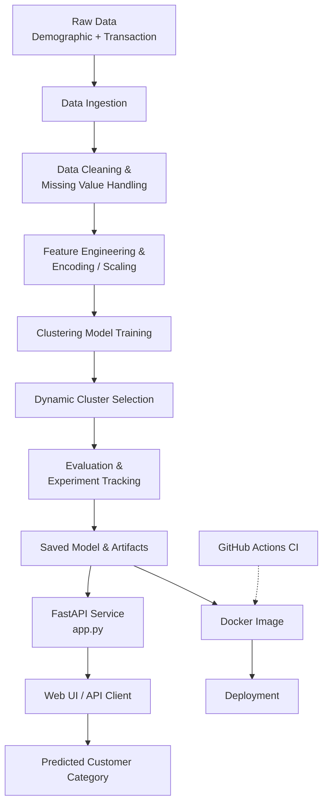

<div align="center">

# 🧩 Customer Categorizer

**End-to-end Machine Learning pipeline to categorize customers using demographic and transaction data.**

Dynamic cluster prediction · FastAPI endpoints · MLOps tracking · Docker deployment · CI via GitHub Actions


</div>

---

## 📌 Overview

Customer Categorizer groups customers into meaningful segments using their **demographic** and **transaction** data. Instead of hard-coding the number of segments, the pipeline supports **dynamic cluster prediction**, and the trained model is exposed through **FastAPI** endpoints so any application can request a customer's category in real time.

The project follows an MLOps-style structure: modular source code, config-driven runs, experiment tracking, a Docker image for reproducible deployment, and a GitHub Actions workflow for CI.

**Typical use cases (BFSI / Fintech / Retail):**
- Customer segmentation for targeted marketing
- Identifying high-value vs. low-engagement customers
- Personalised offers and product recommendations
- Risk and retention analysis by segment

---

## 🔄 Project Flowchart


> 📝 **Note:** Make sure the image path above matches the actual file name inside the `flowchart/` folder (for example `flowchart/pipeline.png`).

<details>
<summary><b>Text version of the flow (Mermaid)</b></summary>



</details>

---

## ✨ Key Features

- **End-to-end ML pipeline**: ingestion → preprocessing → feature engineering → training → prediction
- **Dynamic cluster prediction**: number of customer segments is not fixed blindly
- **FastAPI endpoints**: serve predictions through a REST API
- **Web interface**: simple HTML templates with CSS for manual predictions
- **MLOps tracking**: experiments, parameters and metrics are logged
- **Dockerised**: one-command build and run
- **CI workflow**: automated checks through GitHub Actions
- **Config-driven**: parameters live in the `config/` folder, not buried in code

---

## 🗂️ Project Structure

```
Customer-Categorizer/
├── .github/workflows/   # CI pipeline (GitHub Actions)
├── assignment/          # Problem statement / assignment files
├── config/              # Configuration files
├── docs/                # Additional documentation
├── flowchart/           # Pipeline flowchart image(s)
├── notebooks/           # EDA and experimentation notebooks
├── scripts/             # Helper / pipeline run scripts
├── src/                 # Core source code (pipeline components)
├── static/css/          # Styles for the web UI
├── templates/           # HTML templates for the web UI
├── .dockerignore
├── .gitignore
├── Dockerfile           # Container definition
├── app.py               # FastAPI application entry point
├── requirements.txt     # Python dependencies
├── setup.py             # Package setup
└── README.md
```

---

## 🛠️ Tech Stack

| Area | Tools |
|------|-------|
| Language | Python |
| Data & ML | Pandas, NumPy, scikit-learn |
| API | FastAPI, Uvicorn |
| MLOps / Tracking | Experiment tracking (see `config/` and `src/` for the tool used) |
| Containerisation | Docker |
| CI/CD | GitHub Actions |
| Frontend | HTML, CSS (Jinja templates) |

---

## 🚀 Getting Started

### 1. Clone the repository

```bash
git clone https://github.com/ahmedrajakhan/Customer-Categorizer.git
cd Customer-Categorizer
```

### 2. Create a virtual environment

```bash
python -m venv venv

# Linux / macOS
source venv/bin/activate

# Windows
venv\Scripts\activate
```

### 3. Install dependencies

```bash
pip install -r requirements.txt
```

### 4. Run the application

```bash
uvicorn app:app --reload
```

The app will be available at: **http://127.0.0.1:8000**

Interactive API docs (Swagger UI): **http://127.0.0.1:8000/docs**

---

## 🐳 Run with Docker

```bash
# Build the image
docker build -t customer-categorizer .

# Run the container
docker run -p 8000:8000 customer-categorizer
```

Then open **http://localhost:8000**.

---

## 🔌 API Usage

Open `/docs` after starting the server to see every available endpoint and try them live.

**Example request** (adjust the fields to match the model's input features):

```bash
curl -X POST "http://127.0.0.1:8000/predict" \
  -H "Content-Type: application/json" \
  -d '{
        "age": 35,
        "income": 60000,
        "total_transactions": 42,
        "avg_transaction_amount": 1250.5
      }'
```

**Example response:**

```json
{
  "cluster": 2,
  "category": "High Value Customer"
}
```

> 📝 Endpoint names and input fields above are examples. Update them to match `app.py` and the trained model's features.

---

## 📊 Pipeline Stages

1. **Data Ingestion**: load demographic and transaction data
2. **Data Cleaning**: handle missing values, duplicates and outliers
3. **Feature Engineering**: encode categorical variables, scale numerical features
4. **Model Training**: train clustering model(s) to group similar customers
5. **Dynamic Cluster Selection**: pick a suitable number of clusters from evaluation metrics
6. **Evaluation & Tracking**: log parameters, metrics and artifacts for every run
7. **Serving**: expose the final model through FastAPI
8. **Deployment**: package with Docker, validate with GitHub Actions

---

## 🔁 CI/CD

A GitHub Actions workflow in `.github/workflows/` runs automatically on push / pull request to keep the project healthy and the Docker build reproducible.

---

## 🧭 Roadmap

- [ ] Add model monitoring and drift detection
- [ ] Add unit tests for pipeline components
- [ ] Push Docker image to a container registry
- [ ] Add a dashboard (Power BI / Streamlit) for segment insights
- [ ] Deploy on a cloud platform (AWS)

---

## 🤝 Contributing

Contributions, issues and feature requests are welcome. Feel free to open an issue or submit a pull request.

1. Fork the repo
2. Create a feature branch: `git checkout -b feature/your-feature`
3. Commit your changes: `git commit -m "Add your feature"`
4. Push the branch: `git push origin feature/your-feature`
5. Open a Pull Request

---

## 👤 Author

**Ahmed Raza Khan**
- GitHub: [github.com/ahmedrajakhan](https://github.com/ahmedrajakhan)
- Project: [github.com/ahmedrajakhan/Customer-Categorizer](https://github.com/ahmedrajakhan/Customer-Categorizer)

---

<div align="center">

⭐ If you found this project useful, consider giving it a star!

</div>
